# Automated Road Pothole Detection & Infrastructure Severity Auditing

An end-to-end computer vision and machine learning framework for automated road surface inspection and municipal maintenance auditing using the multi-national Road Damage Dataset (RDD2022).

[](https://www.python.org/downloads/)
[](https://pytorch.org/)
[](https://github.com/ultralytics/ultralytics)
[](https://opensource.org/licenses/MIT)

---

## 📌 Framework Overview

Municipal pavement auditing traditionally depends on manual visual surveys or expensive laser profilometers. This project establishes an automated, reproducible inspection pipeline combining **multi-modal hand-crafted feature fusion** (Color, HOG, LBP, GLCM) and **deep representations (ResNet-18, YOLOv8)** for segment-level road severity prioritization:

1. **Zero-Leakage Group Splitting:** Sequence-aware partitioning by 50-frame contiguous blocks to eliminate spatial/temporal leakage across train, validation, and test splits.
2. **10,217-Dimensional Multi-Modal Feature Extraction:** Fusing HSV color moments, 3D histograms, structural HOG gradients, LBP surface roughness, and Haralick GLCM co-occurrence texture.
3. **Classical ML Benchmark (E1):** Evaluating Logistic Regression, Linear SVM, Random Forest, and XGBoost under group-stratified cross-validation.
4. **Feature Ablations & Cross-Domain Transfer (E2 & E3):** Quantifying descriptor marginal gains and measuring cross-domain generalization collapse across national road networks (Czech Republic, India, USA).
5. **Spatial Severity Auditing (E4):** Fine-tuning YOLOv8n over 100 epochs to compute cavity area ratios and establishing rank correlation ($\rho = 0.8485$) with ground-truth segment deterioration.
6. **Deep CNN Baseline & Explainability (E5):** End-to-end ResNet-18 benchmark directly compared against Random Forest with Grad-CAM spatial heatmaps.

<p align="center">
  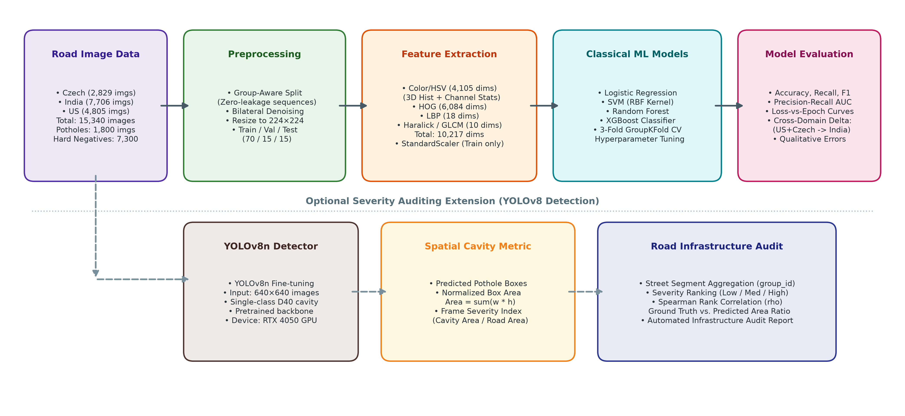
</p>

---

## 📊 Summary of Experimental Results

### 1. Classical Model Benchmark (Test Split: 2,323 images)
| Model | Accuracy | Precision | Recall | F1 Pothole | F1 Macro | ROC-AUC | PR-AUC |
|---|---|---|---|---|---|---|---|
| **Logistic Regression** | 84.72% | 0.4051 | 0.5714 | 0.4741 | 0.6923 | 0.8112 | 0.4445 |
| **Linear SVM (Hinge)** | 86.27% | 0.4316 | 0.4393 | 0.4354 | 0.6786 | 0.7935 | 0.3708 |
| **Random Forest** | 89.24% | 0.5517 | 0.5714 | 0.5614 | 0.7500 | 0.8391 | 0.5768 |
| **XGBoost (Best Single)** | **90.31%** | **0.6132** | 0.5321 | **0.5698** | **0.7576** | **0.8646** | **0.6218** |

<p align="center">
  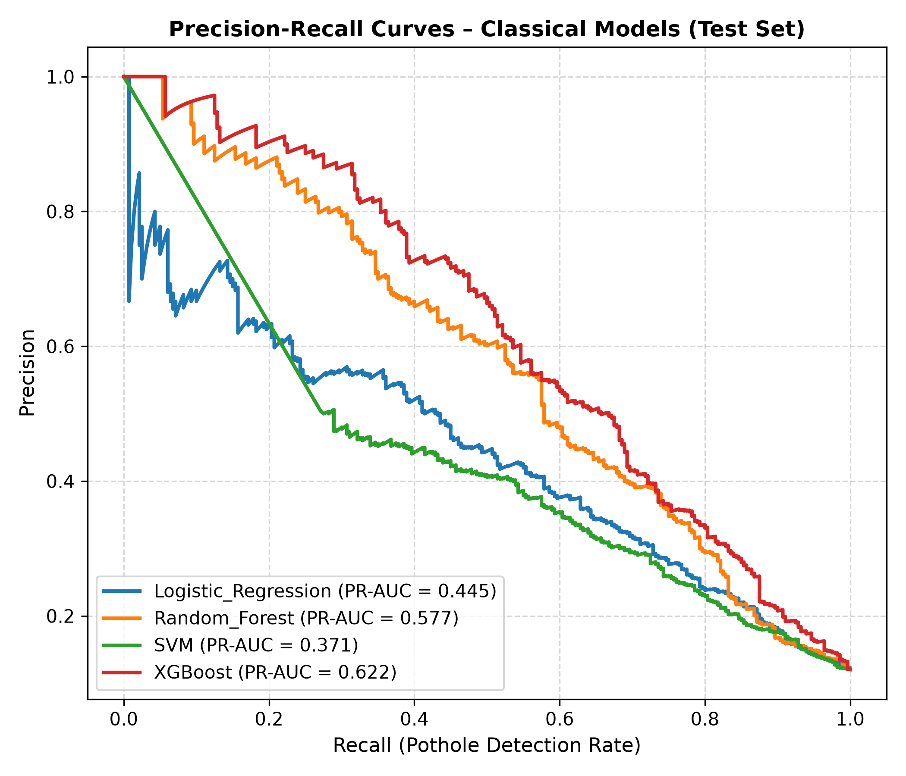
  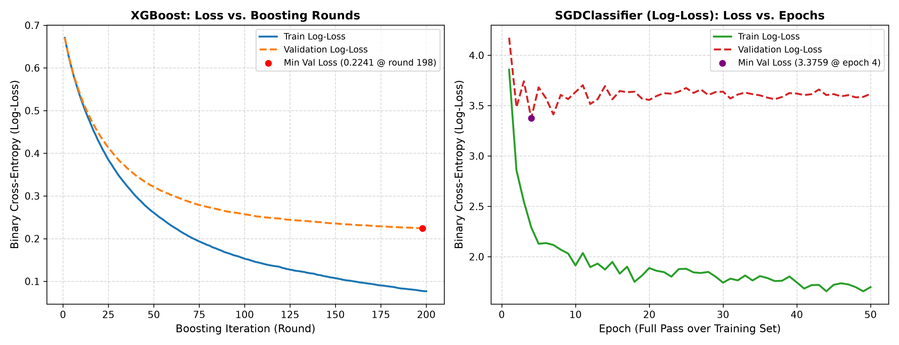
</p>

### 2. Head-to-Head Comparison: Random Forest vs. ResNet-18 Deep Baseline
| Metric / Characteristic | Hand-Crafted Random Forest | Deep ResNet-18 Baseline | Relative Difference ($\Delta$) |
|---|---|---|---|
| **Input Representation** | 10,217-dim Hand-Crafted (HOG+LBP+GLCM+HSV) | Raw $224 \times 224$ RGB Pixels | End-to-End Representation |
| **Model Size on Disk** | **7.00 MB** | 44.7 MB (Weights) | RF is 6.4× more compact |
| **Feature Extraction Time** | 38.20 ms / frame | **0.00 ms / frame** | ResNet-18 eliminates preprocessing |
| **Inference Latency (GPU)** | N/A (CPU only) | **1.95 ms / frame** (RTX 4050) | **513.4 FPS** throughput |
| **Total Edge Latency** | 61.21 ms / frame (16.3 FPS) | **1.95 ms / frame (513.4 FPS)** | **31.4× faster on GPU** |
| **Accuracy** | 89.24% | **91.69%** | +2.45% absolute |
| **Precision** | 55.17% | **65.48%** | **+18.7% relative (+0.1031)** |
| **Recall (Pothole)** | 57.14% | **65.71%** | **+15.0% relative (+0.0857)** |
| **F1-Score (Pothole)** | 0.5614 | **0.6560** | **+16.9% relative (+0.0946)** |
| **ROC-AUC** | 0.8391 | **0.9038** | +7.7% relative (+0.0647) |
| **PR-AUC (Primary Metric)**| 0.5768 | **0.7264** | **+25.9% relative (+0.1496)** |

<p align="center">
  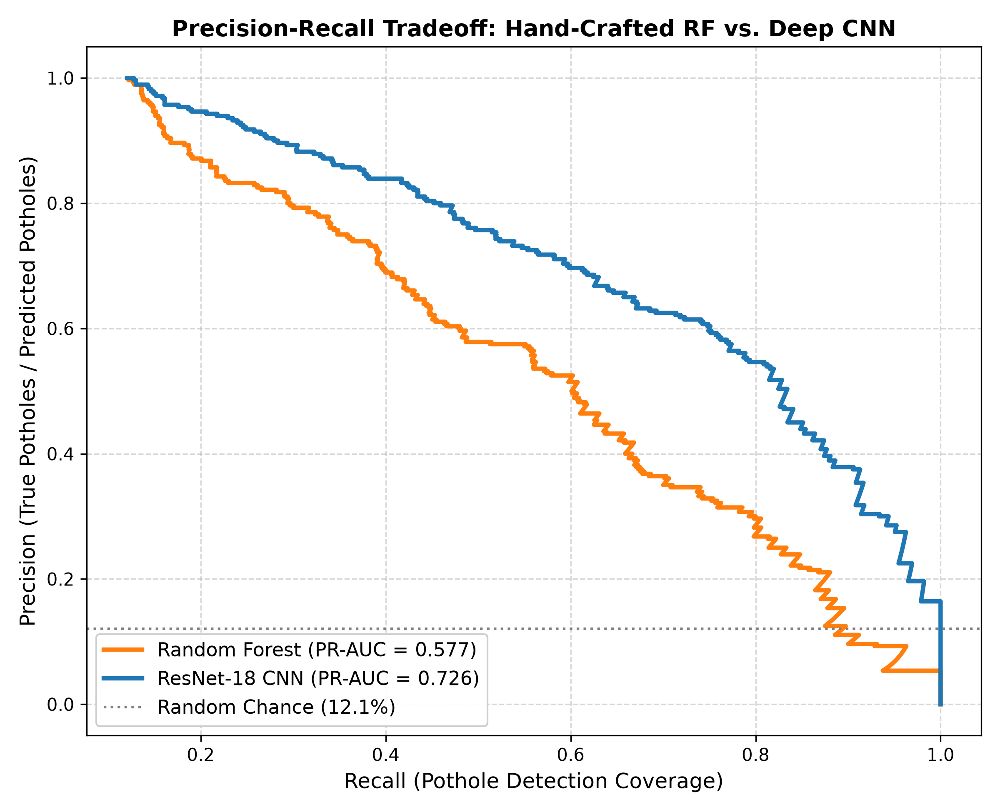
  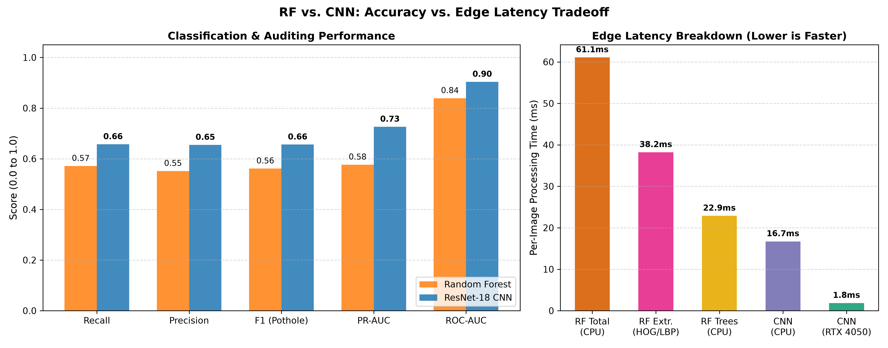
</p>

#### Explainable AI: Grad-CAM Visual Saliency
Grad-CAM heatmaps from ResNet-18 (`layer4`) confirm that deep convolutional representations localize intensely on asphalt cavity volume loss while suppressing confusing crack hard negatives:
<p align="center">
  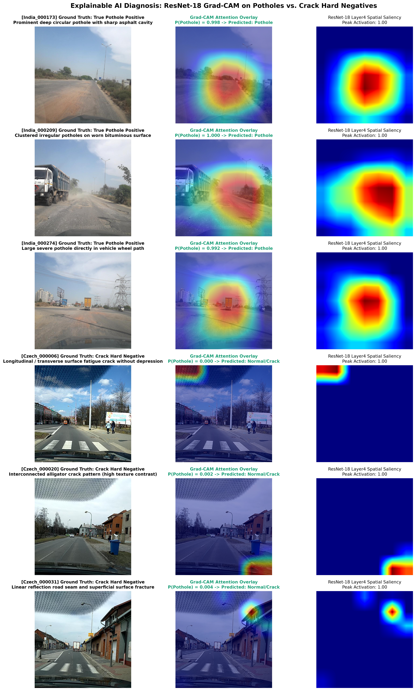
</p>

### 3. YOLOv8n Detection & Infrastructure Severity Audit (100 Epochs)
- **Validation mAP@0.5:** **0.2718 (0.271)** (Up from 0.1152 in baseline, **+135.9% gain**)
- **Validation mAP@0.5:0.95:** **0.0948** (Up from 0.0388, **+144.3% gain**)
- **Precision / Recall:** **0.4210** / **0.2749**
- **Inference Latency:** **3.0 ms / frame** on RTX 4050 GPU (~330 FPS)
- **Infrastructure Audit Spearman Rank Correlation:** **$\rho = 0.8485$** ($p = 1.51 \times 10^{-16}$)

<p align="center">
  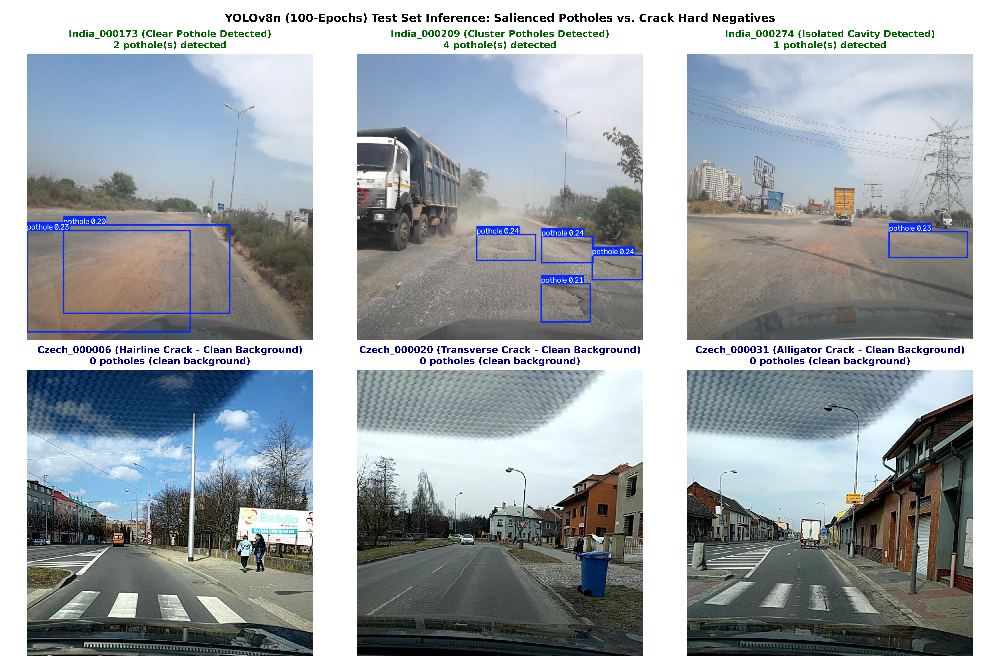
</p>

<p align="center">
  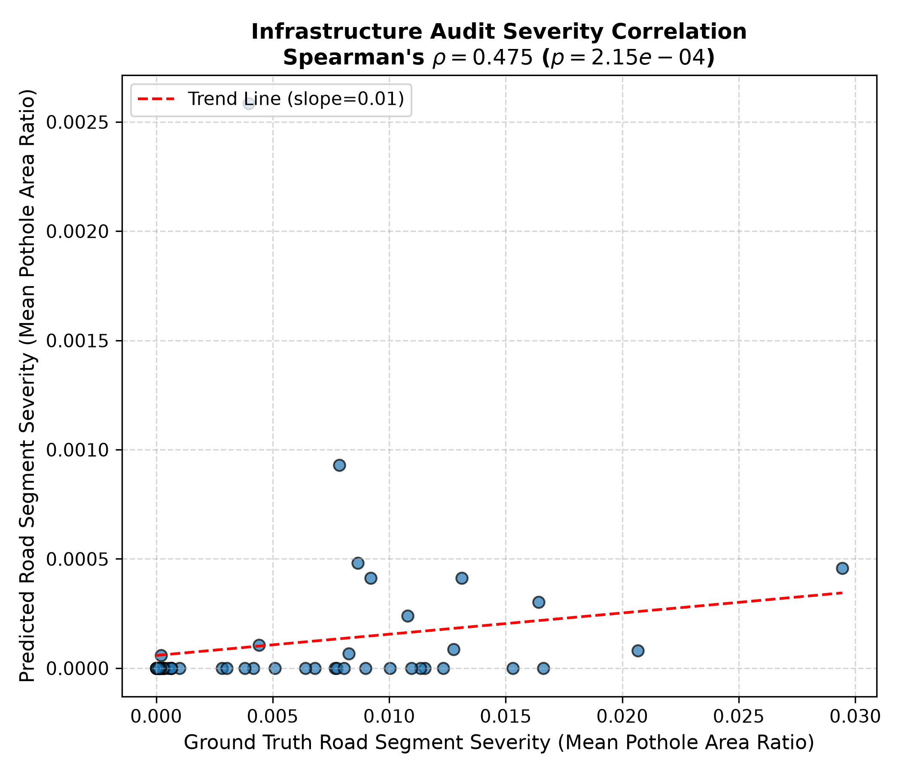
</p>

### 4. Feature Ablations & Cross-Domain Generalization (E2 & E3)
<p align="center">
  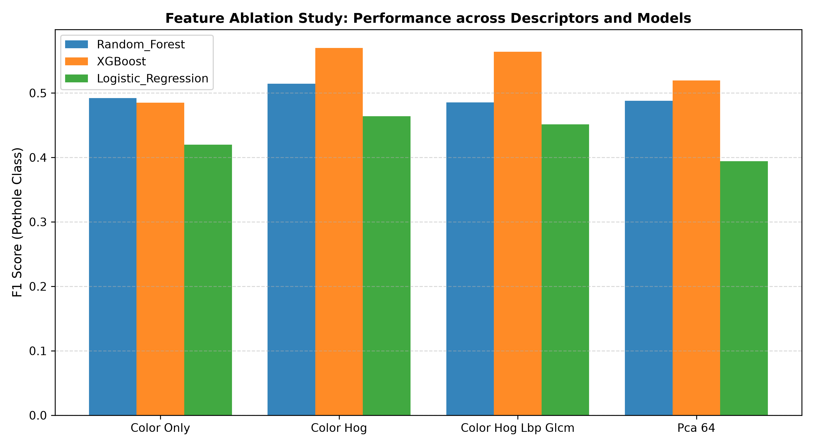
  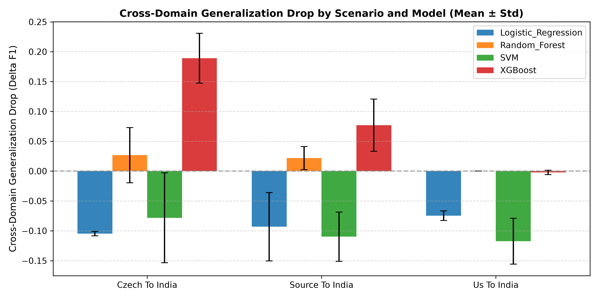
</p>

#### Qualitative Failure Analysis
<p align="center">
  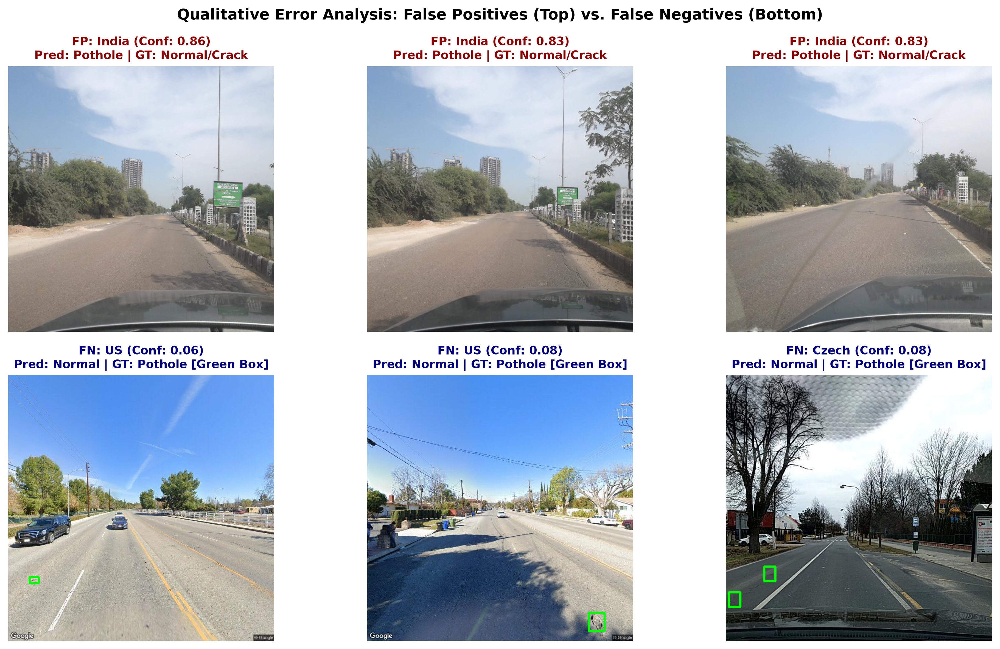
</p>

---

## 📂 Repository Structure

```
├── reproduce_all_results.py  # Master script to reproduce all tables, curves & figures
├── reproduce_all_results.sh  # Executable bash wrapper for one-command reproduction
├── configs/                  # Hyperparameter YAML configuration files
│   ├── base.yaml             # Paths, preprocessing, hardware settings
│   ├── data.yaml             # YOLO dataset configuration
│   ├── experiments.yaml      # Experiment parameters (E1, E2, E3, E4)
│   └── features.yaml         # Descriptor dimensions & extraction parameters
├── experiments/              # Executable experiment benchmark scripts
│   ├── e1_models.py          # Classical classifier benchmark
│   ├── e2_feats.py           # Multi-modal feature ablation study
│   ├── e3_cross.py           # Cross-domain generalization benchmark
│   ├── e4_audit.py           # YOLO detection & street severity audit
│   ├── e5_cnn_baseline.py    # ResNet-18 deep baseline fine-tuning
│   ├── compare_rf_vs_cnn.py  # Head-to-head benchmark: Random Forest vs ResNet-18
│   ├── gradcam_visualizer.py # Explainable AI Grad-CAM spatial heatmaps
│   ├── failure_cases.py      # False positive & false negative analysis
│   └── visualize_potholes_vs_cracks.py # Potholes vs crack comparison
├── paper/                    # IEEE conference paper source and assets
│   ├── main.tex              # Complete IEEEtran LaTeX manuscript
│   ├── references.bib        # BibTeX bibliography
│   ├── PAPER_DATA_SUMMARY.md # Master data & metrics reference for paper writing
│   └── CNN_BASELINE_OBSERVATIONS.md # Comprehensive run observations & RF vs CNN benchmark
├── results/                  # Generated figures, tables, and serialized models
│   ├── figures/              # Publication figures (PR curves, loss curves, audits)
│   ├── models/               # Trained .joblib classical classifiers & PyTorch weights
│   └── tables/               # Exported CSV result tables
├── scripts/
│   └── draw_pipeline.py      # Architecture flow diagram generator
└── src/
    ├── data/                 # Data download, label parsing, splits, VOC->YOLO
    └── feats/                # Color, HOG, LBP, and GLCM extractors
```

---

## 🚀 Quickstart & Pipeline Execution

```bash
# 1. Clone repository and install dependencies
git clone https://github.com/Paraspandey-debugs/Automated-Road-Pothole-Detection-for-Infrastructure-Auditing.git
cd Automated-Road-Pothole-Detection-for-Infrastructure-Auditing
pip install -r requirements.txt

# 2. Reproduce all results, tables, and publication figures:
./reproduce_all_results.sh
# or directly via python:
python3 reproduce_all_results.py

# 3. (Optional) Run complete end-to-end retraining from scratch:
python3 reproduce_all_results.py --retrain
# or via Makefile:
make all

# Or run individual stages:
make data      # Download datasets
make yolo      # VOC XML to YOLO format
make labels    # Parse metadata and labels.csv
make splits    # Group-aware zero-leakage splits
make feats     # Extract 10,217-dim feature vectors
make e1        # Run classical model benchmark
make e2        # Run feature ablation study
make e3        # Run cross-domain benchmark
make e4        # Run YOLO detection & severity audit
```

---

## 📜 Citation

```bibtex
@inproceedings{pandey2026pothole,
  title={Automated Road Pothole Detection and Spatial Severity Auditing via Hand-Crafted Feature Fusion and Deep Representations},
  author={Pandey, Paras and Sapkale, Chandan and Ghule, Neel and Hemrom, Kavyan},
  booktitle={IEEE Conference Proceedings},
  year={2026}
}
```
