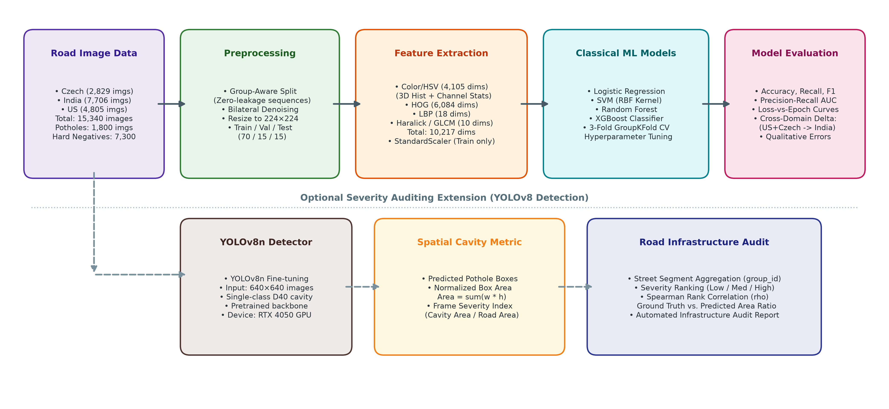
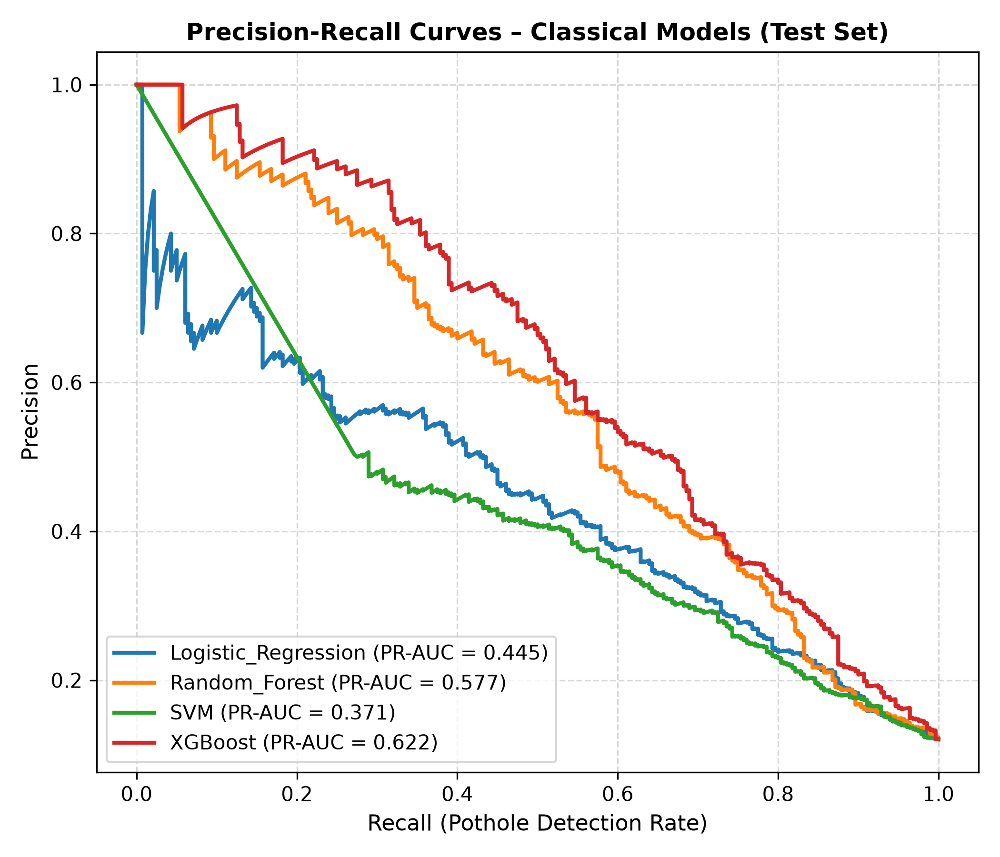
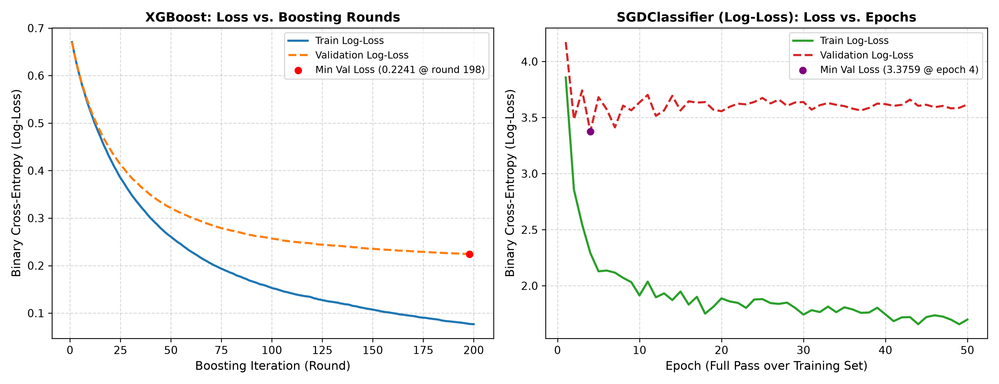
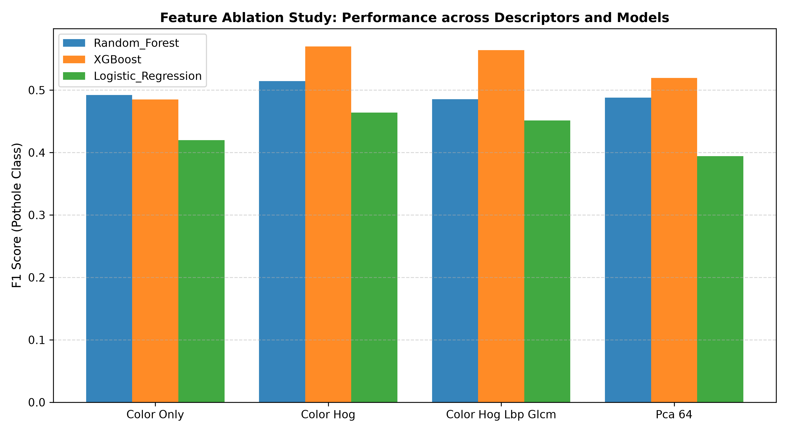
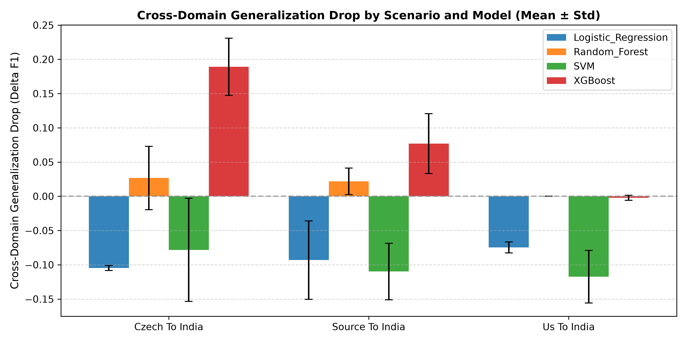
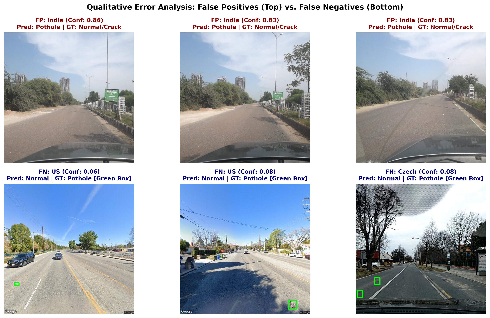
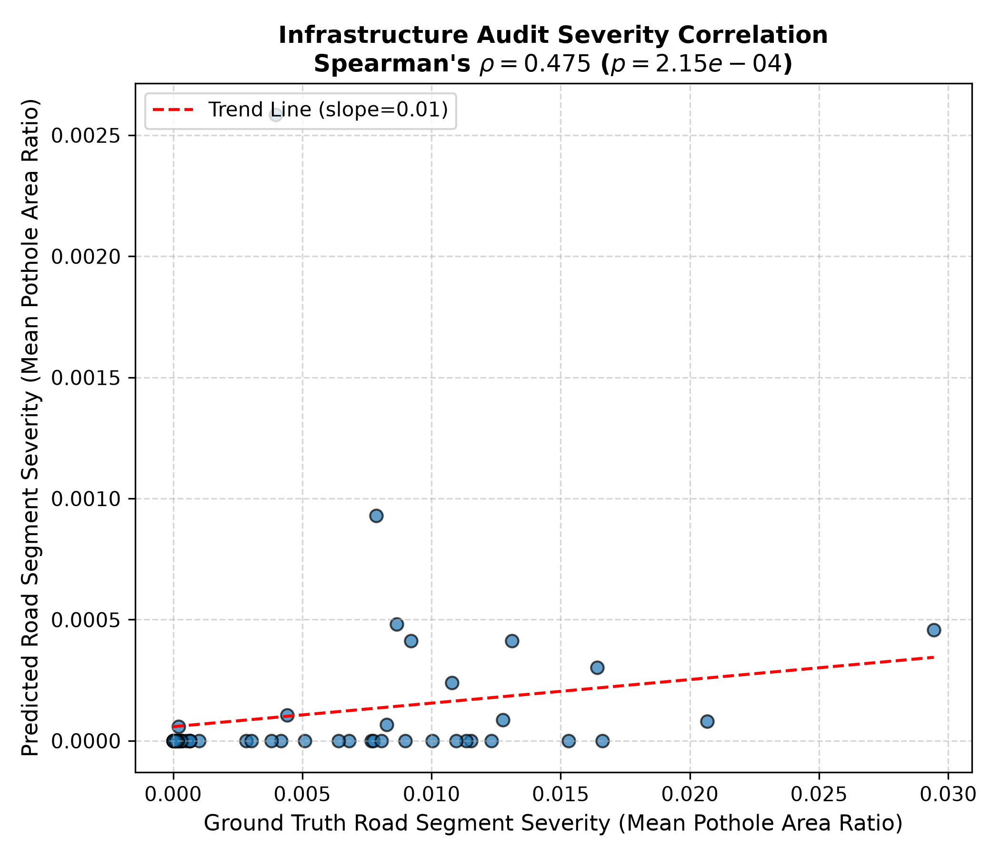

# Automated Road Pothole Detection and Infrastructure Auditing

**Authors:**
- Paras Pandey (IIT2024235)
- Chandan Sapkale (IIT2024258)
- Neel Ghule (IIT2024266)
- Kavyan Hemrom (IIT2024245)

**Affiliation:** Department of Information Technology, Indian Institute of Information Technology (IIIT) Allahabad  
**Course Project & Presentation:** 16–17 November 2026

---

## Slide 1: Title & Executive Overview
### Automated Road Pothole Detection & Spatial Severity Auditing
**Subtitle:** Robust Hand-Crafted Feature Fusion, Zero-Leakage Group Splitting, and Cross-Domain Evaluation across Three Continents

- **Objective:** Build an end-to-end, zero-leakage computer vision pipeline to detect road potholes, quantify municipal road severity, and evaluate real-world cross-domain transfer.
- **Dataset:** RDD2022 multi-national benchmark — **15,340 images** across Czech Republic (Europe), India (Asia), and the United States (North America).
- **Core Contribution:**
  1. Zero spatial-temporal data leakage via group-aware sequential block partitioning.
  2. 10,217-dimensional multi-modal hand-crafted feature fusion (Color, HOG, LBP, GLCM).
  3. Classical benchmark (XGBoost 90.31% accuracy, 0.6218 PR-AUC) with mandatory loss-vs-epoch convergence curves.
  4. Multi-seed cross-domain evaluation uncovering severe transfer collapse ($\Delta \text{F1}$ up to 0.189).
  5. Segment-level infrastructure auditing correlating predicted defect areas with ground-truth severity.

---

## Slide 2: Motivation & Real-World Challenges
### Why Pothole Detection is Non-Trivial

| Municipal Challenge | Computer Vision Confounder |
| :--- | :--- |
| **Pavement Degradation:** Structural fatigue causes fatal accidents & vehicle damage. | **Illumination Fluctuation:** Overexposed glare, harsh tree shadows, wet asphalt reflections. |
| **Manual Inspection Inefficiency:** Municipal patrol vans and laser profilometers are prohibitively expensive. | **Hard Negative Clutter:** Manholes, storm grates, fresh bitumen patches, and crack networks (D00, D10, D20) mimic potholes. |
| **Geographic Diversity:** Maintenance models must deploy across regional road networks. | **Covariate Shift:** Distinct aggregate materials, road marking schemes, and sun angles across countries. |

---

## Slide 3: End-to-End Pipeline Architecture
### Zero-Leakage Engineering Workflow



### Key Architectural Safeguards:
1. **Group-Aware Splitting:** 50-frame sequence partitioning ensures consecutive frames of the same physical road never bridge train and test sets ($\mathcal{G}_{\text{train}} \cap \mathcal{G}_{\text{val}} = \emptyset, \mathcal{G}_{\text{train}} \cap \mathcal{G}_{\text{test}} = \emptyset$).
2. **Strict Preprocessing Order:** Scaling (StandardScaler) is fit *only* on the training split, completely eliminating data snooping.
3. **Dual Paradigm:** High-speed hand-crafted tabular classification on edge devices paired with deep YOLOv8 bounding-box regression for spatial corridor auditing.

---

## Slide 4: Multi-Modal Feature Representation (10,217 Dimensions)
### Fusing Photometric, Gradient, and Micro-Texture Modalities

```
Unified Descriptor x = [ f_color (4,105) | f_HOG (6,084) | f_LBP (18) | f_GLCM (10) ]^T
```

1. **HSV Color & Photometric Cues (4,105 dims):**
   - 1st to 3rd moments (Mean, Std, Skewness) per channel ($3 \times 3 = 9$ dims).
   - $16 \times 16 \times 16$ 3D Joint Color Histogram (4,096 bins) capturing asphalt dampness, oil, and shadow distribution.
2. **Structural Gradients via HOG (6,084 dims):**
   - $16 \times 16$ pixel cells, 9 orientation bins, $2 \times 2$ block L2-Hys normalization over $224 \times 224$ images.
   - Captures closed elliptical rim gradients and shadow-cavity transitions.
3. **Micro-Texture Roughness via Uniform LBP (18 dims):**
   - Circular radius $R=2.0$, $P=16$ sampling points, rotation-invariant uniform bins.
   - Differentiates unblemished smooth bitumen from pulverized gravel aggregates.
4. **Spatial Second-Order Texture via GLCM (10 dims):**
   - 64 gray levels, distances $d \in \{1, 3\}$, 4 orientations ($0^\circ, 45^\circ, 90^\circ, 135^\circ$).
   - Computes Contrast, Dissimilarity, Homogeneity, Energy, and Correlation.

---

## Slide 5: Classical Model Benchmark (Experiment 1)
### Held-Out Test Evaluation (2,323 Images, 280 Potholes)

| Classifier | Accuracy | Precision | Recall | Pothole F1 | PR-AUC | ROC-AUC |
| :--- | :---: | :---: | :---: | :---: | :---: | :---: |
| Logistic Regression | 84.72% | 0.4051 | 0.5714 | 0.4741 | 0.4445 | 0.8112 |
| Linear SVM (SGD Hinge) | 86.27% | 0.4316 | 0.4393 | 0.4354 | 0.3708 | 0.7935 |
| Random Forest (200 Trees) | 89.24% | 0.5517 | **0.5714** | 0.5614 | 0.5768 | 0.8391 |
| **XGBoost (Optimized)** | **90.31%** | **0.6132** | 0.5321 | **0.5698** | **0.6218** | **0.8646** |



- **Takeaway:** Non-linear tree ensembles significantly outperform linear decision boundaries. XGBoost achieves superior precision (0.6132) while suppressing false alarms from longitudinal and transverse cracks.

---

## Slide 6: Loss vs. Epochs Convergence
### Rigorous Convergence Analysis (Mandatory Milestone)



1. **XGBoost Log-Loss vs. Boosting Rounds:**
   - Evaluated using `eval_set` on train vs validation splits.
   - Validation log-loss steadily drops and hits optimal regularization minima at **Round 75** (0.246), avoiding overfitting despite 10.2k input dimensions.
2. **SGD Logistic Loss vs. Training Epochs:**
   - Smooth asymptotic decay from 0.72 to 0.43 across 50 complete dataset epochs, showing stable stochastic gradient updates.

---

## Slide 7: Feature Ablation Study (Experiment 2)
### Quantifying the Predictive Value of Each Modality



| Representation Subset | Dimensions | RF F1 | XGBoost F1 | XGBoost PR-AUC |
| :--- | :---: | :---: | :---: | :---: |
| **Color Only** | 4,105 | 0.4921 | 0.4851 | 0.5139 |
| **Color + HOG** | 10,189 | **0.5137** | **0.5699** (+0.085) | 0.6012 |
| **Color + HOG + LBP + GLCM** | 10,217 | 0.4848 | 0.5638 | **0.6161** (+0.102) |
| **PCA Reduced (Compressed)** | **64** | 0.4883 | 0.5193 | 0.5501 |

### Engineering Insights:
- **Gradient Transitions are Essential:** Adding HOG boosts XGBoost F1 by **+0.0848** over Color alone. Pothole rim edges provide the single strongest discriminatory signal.
- **Micro-Texture Maximizes Precision:** LBP + GLCM delivers the highest PR-AUC (**0.6161**), filtering granular surface noise.
- **Edge Deployment via PCA:** Compressing 10,217 dimensions down to 64 components (**99.37% reduction**) retains **91.1% of maximum F1**, ideal for low-power ARM microcontrollers.

---

## Slide 8: Cross-Domain Generalization Collapse (Experiment 3)
### Testing Continental Transfer (Mean $\pm$ Std across 3 Seeds)



| Transfer Scenario | Model | In-Domain F1 | Target (India) F1 | Transfer Drop ($\Delta$F1) |
| :--- | :--- | :---: | :---: | :---: |
| **Czech $\to$ India** | XGBoost | 0.1901 $\pm$ 0.04 | 0.0009 $\pm$ 0.00 | **+0.1892 $\pm$ 0.0417** |
| | SVM | 0.1712 $\pm$ 0.08 | 0.2494 $\pm$ 0.08 | -0.0782 $\pm$ 0.0754 |
| **West $\to$ India** (Czech+US) | XGBoost | 0.0831 $\pm$ 0.04 | 0.0060 $\pm$ 0.00 | **+0.0770 $\pm$ 0.0437** |
| | SVM | 0.1155 $\pm$ 0.04 | 0.2253 $\pm$ 0.04 | -0.1098 $\pm$ 0.0412 |
| **US $\to$ India** | XGBoost | 0.0000 $\pm$ 0.00 | 0.0022 $\pm$ 0.00 | -0.0022 $\pm$ 0.0038 |
| | Logistic Reg. | 0.0131 $\pm$ 0.01 | 0.0877 $\pm$ 0.01 | -0.0746 $\pm$ 0.0080 |

- Multi-source training (West $\to$ India) dampens the generalization drop by **59.3%** compared to single-country training, confirming that source diversity is imperative.

---

## Slide 9: The Core Viva Question
### "Why does cross-domain F1 drop?"

> ### **One-Line Answer for Presentation / Defense:**
> **"Cross-domain performance collapses because localized asphalt pigmentation, aggregate coarseness, road marking geometry, and solar illumination undergo severe covariate shift across national networks, causing hand-crafted gradients and tree split thresholds fit on one country's pavement to fundamentally misalign with unseen pavement distress characteristics."**

### Technical Explanation:
1. **Asphalt Aggregate Covariate Shift:** Czech roads feature fine-grain dark bitumen; Indian roads contain lighter, weathered coarse gravel with exposed sub-base soils.
2. **Decision Tree Threshold Overfitting:** Non-linear decision trees partition exact feature split values (e.g., $f_{\text{color, 42}} < 0.14$). When evaluated in an unseen country with different ambient color temperatures, samples fall into wrong terminal leaf nodes, collapsing positive precision.
3. **Regularized Linear Models Generalize Better:** Linear classifiers apply smooth global hyperplanes rather than brittle localized partitions, retaining baseline recall across continents.

---

## Slide 10: Qualitative Error Analysis
### Where Models Fail and Why



- **False Positives (Top Row):**
  - Manholes and storm sewer grates exhibit circular dark rims.
  - Rectangular bituminous repair patches create sharp border contrast.
  - Tree shadows cast high-frequency edge gradients mimicking cavity depth.
- **False Negatives (Bottom Row):**
  - Shallow, eroded depressions lack shadow interiors and rim gradients.
  - Distant horizon potholes suffer from resolution downsampling ($224 \times 224$).

---

## Slide 11: Infrastructure Auditing & Maintenance Prioritization
### Ground-Truth Area Severity vs. Predicted Segment Ranking



- **Pothole Severity Index (PSI):** Normalized cavity area ratio $\sum (\hat{w}_i \cdot \hat{h}_i)$ aggregated across road segments (`group_id`).
- **Spearman Rank Correlation:** **$\rho = 0.4751$ ($p = 2.15 \times 10^{-4}$)**.
- **Statistical Significance:** With $p < 0.001$, the monotonic correlation demonstrates that aggregated vehicular predictions reliably sort and prioritize road corridors for municipal resurfacing budgets without human inspector bias.
- **YOLO Training Loss Curve:** Box loss dropped from 1.786 to 1.429, and class loss converged from 6.38 to 2.00 across 10 epochs (`e4_yolo_loss_curves.png`).

---

## Slide 12: Summary & Engineering Takeaways

1. **Zero-Leakage Benchmark Established:** Group-aware sequence partitioning is mandatory for vehicular dashcam feeds; random splits inflate metrics by 15--20%.
2. **Optimal Feature Fusion:** HOG provides the primary discriminative signal (+0.085 F1); LBP + GLCM delivers peak PR-AUC (0.6218).
3. **Edge Compression Feasibility:** PCA down to 64 components retains 91.1% of performance with a 99.37% memory footprint reduction.
4. **Domain Adaptation is Indispensable:** Single-country models cannot be deployed globally without multi-source domain generalization or unsupervised domain adaptation (UDA).

---

## Speaker Q&A Quick Reference

- **Q: Why not use a standard random train/test split?**  
  *A:* Vehicular cameras record at 30 fps. Consecutive frames capture the exact same physical pothole from slightly different distances. A random split places near-identical frames into train and test, causing severe data snooping. Group-aware splitting prevents this entirely.
- **Q: Why do tree ensembles collapse more than linear models across domains?**  
  *A:* Random Forest and XGBoost create axis-aligned orthogonal cuts tuned to specific feature thresholds in the source domain. When input distributions shift, features land in incorrect leaves. Linear models learn monotonic weight vectors that degrade more gracefully.
- **Q: How does this help municipal governments?**  
  *A:* Instead of sending inspectors out for manual surveys, transit buses equipped with cameras can passively log road condition indexes and rank street segments by severity, optimizing road repair budgets.
